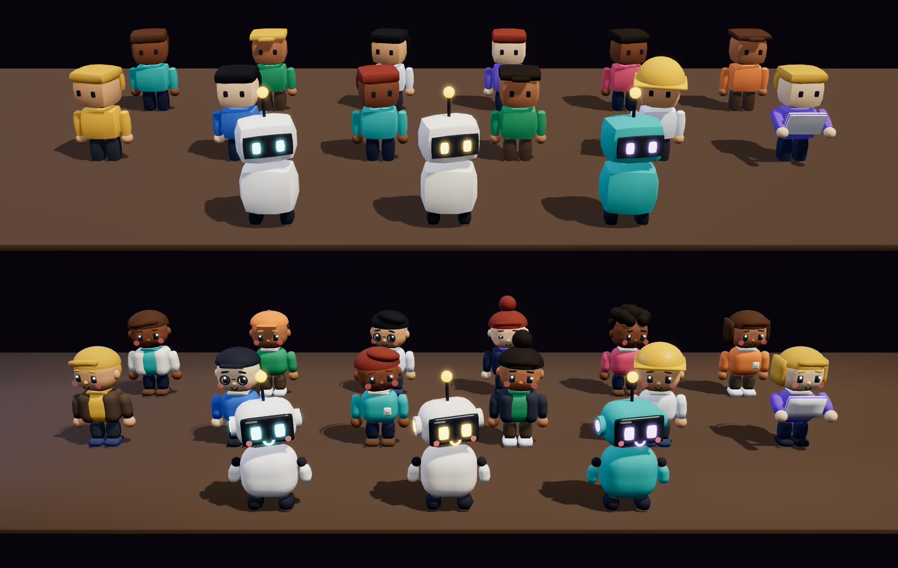
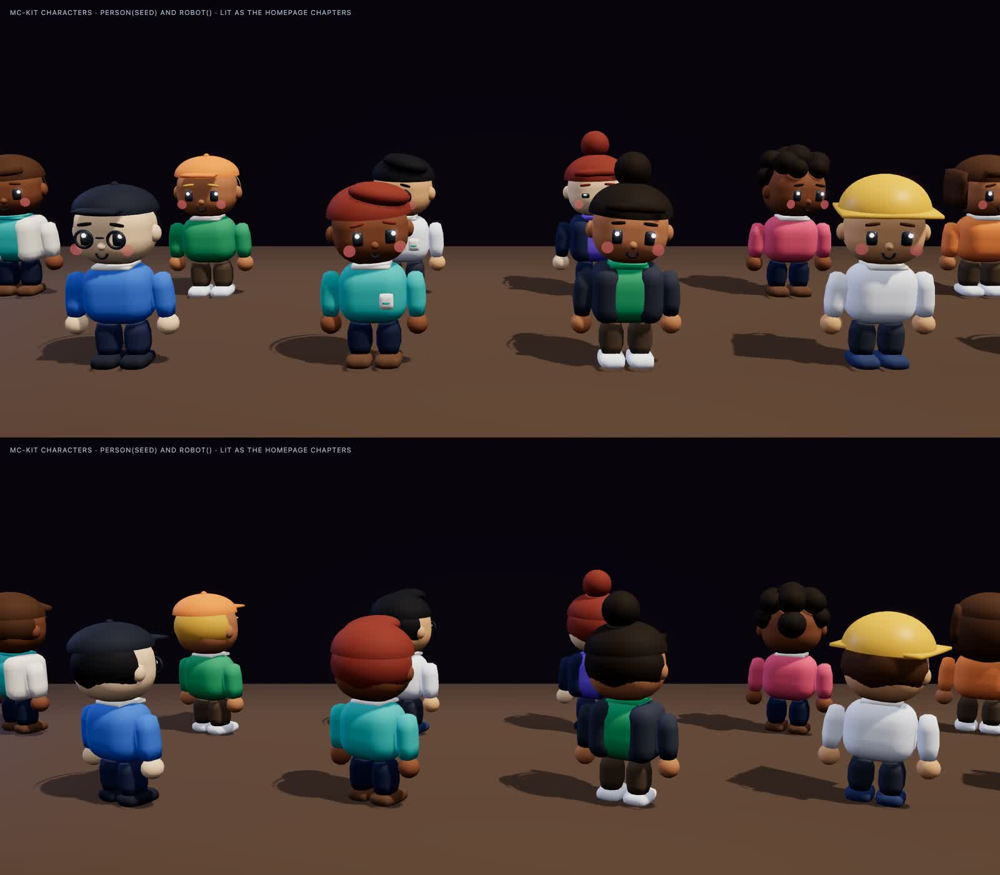
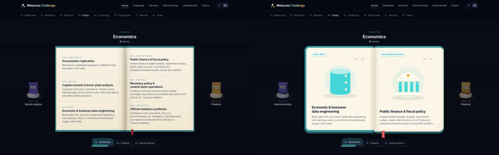
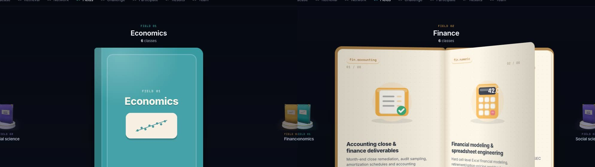
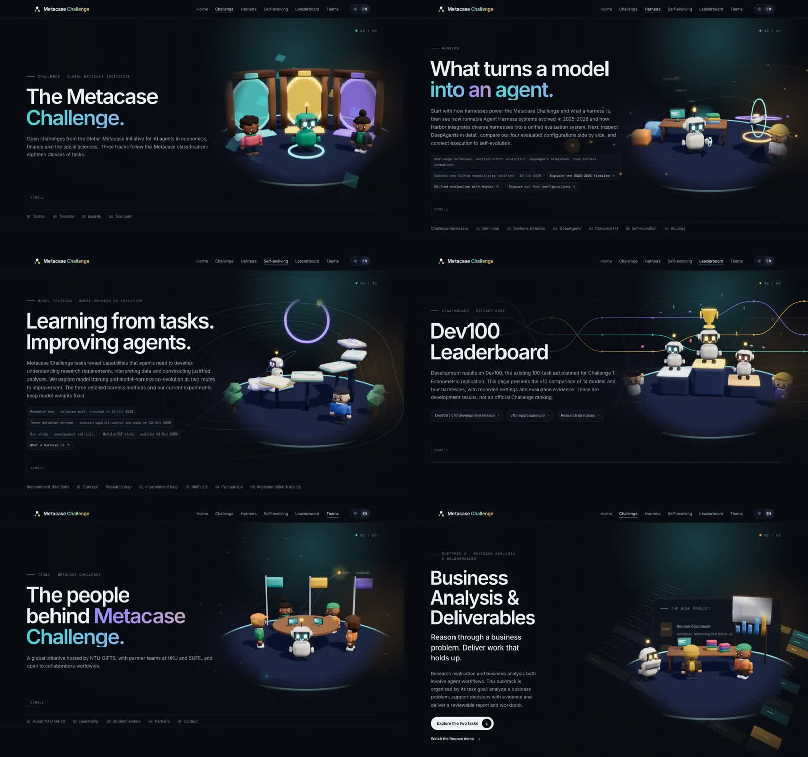
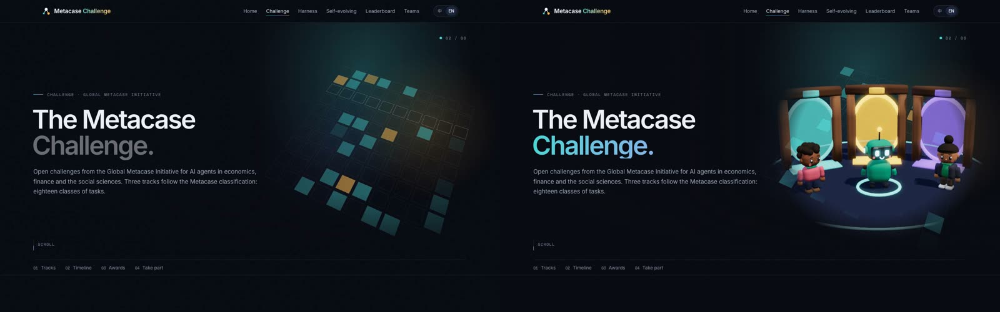
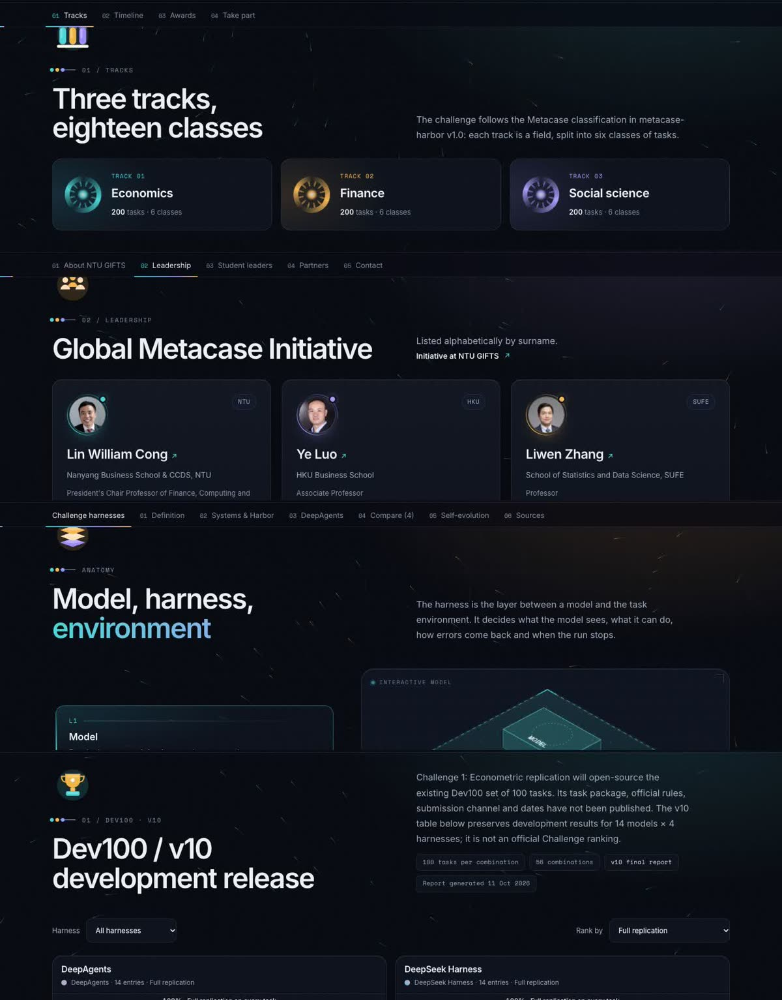
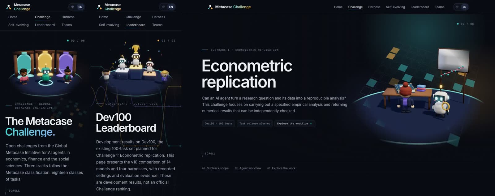

# 2026-11-02 夜间迭代：卡通角色、Fields 书、子页面画风

分支 `design/toon-polish-20261102`，基于 `main` 的 `b81260c`，4 个改动提交加 1 个说明提交（即本文件），**只在本地，没有推送**。

| 提交 | 内容 |
| --- | --- |
| `db416e1` | 所有卡通人物和机器人重做（`mc-kit.js`），附角色样张页 |
| `d474ed4` | Fields 章的书改成玩具书，逐页翻动、滑动转场（`metacase.js` / `metacase.css` / `mc-classart.js`） |
| `cb9cf5c` | 七个子页面接入首页画风：3D 页首场景、渐变标题、玩具卡片、章节插画（`subpage-toy*.js/css`） |
| `244dc2a` | 新文件加入发布白名单（`scripts/check.mjs`）；修掉子页面原有的横向溢出 |

## 1. 卡通角色

全站人物和机器人都出自 `mc-kit.js` 的 `person()` / `robot()`，所以改这一处，首页各章、Arena、Challenge 落地页以及新的子页面场景会一起变。

- **人物**：圆头圆脸，眼睛有高光，加了眉毛、腮红、鼻子、微笑和耳朵。发型有六种，都用弧面做成：短发、鸭舌帽、侧分、丸子头、卷发、波波头，有的角色戴圆眼镜。衣服有敞开的外套、胸牌、领口和鞋子。站着时会轻微晃动，并定时眨眼。
- **机器人**：胶囊形的眼睛会眨，有发光的笑脸、腮红、会发光的耳机，面罩上有反光，还加了手臂。Arena 的盔甲换色用的子元素顺序和三种颜色保持不变，所以 Arena、Challenge 落地页、穿梭动画都不用改。
- **圆角方块**（`rbox`）：法线改为共享的光滑法线，大圆角的分段数也加多了，不再看得出棱角。全站方块都会更圆润。




样张页 `docs/design/character-lab.html`：本地起服务后可以打开 `?view=people`、`?view=robots`、`?view=all`，加 `&yaw=2.6` 可以看背面。

## 2. Fields 章的书

- **画风**：改成玩具书。粗圆角硬壳，下面有一圈实心的厚边，露出一层层书页；纸张是暖色加点阵；封面有针脚书脊和凸起的面板；右页有折角。
- **一页一类**：每个领域分成三个展开页，每页一类，配一张专属插画（18 张，用该领域的颜色）、类别标签和页码。
- **翻动**：滚动经过该领域那一段时，书页一页页翻过去；点击右页往后翻，点击左页往前翻。翻完后插画弹出，文字依次浮现。
- **滑动**：换领域时，旧书合上并朝转动方向滑走、略微倾斜；新书从封面小图里带一点回弹弹出来。
- **手机**：保持纵向排列，每一类左边带一个小插画徽章。
- 滚动轨道从 200vh 加长到 330vh，否则三个展开页翻得太快。
- 中文版正常，插画和页码不参与翻译。




## 3. 子页面

七个页面都改了：Challenge、Harness、Self-evolving、Leaderboard、Teams、Business Analysis、Replication。

- **3D 页首**：每页右侧一个专属小场景，用的是新角色，统一放在一个圆台上。
  - Challenge：三扇传送门
  - Harness：工作台，旋转的 Harness
  - Self-evolving：机器人沿 Metacase 方块台阶往上爬
  - Leaderboard：领奖台、奖杯和彩纸
  - Teams：圆桌和三家机构的旗子
  - Business Analysis：放在原有的右侧面板里，那个面板的信息全部保留
  - Replication：读书的研究员，拿放大镜的机器人
  
  场景背景透明，和页面原有的背景动画叠在一起，边缘渐隐。滚出视野时暂停，开启"减少动态效果"时只画一帧；手机上放在标题上方。
- **标题**：第二行换成首页的青—紫—琥珀渐变。
- **卡片**：圆角加大，底下有实心厚边，鼠标悬停时带回弹地抬起。
- **章节插画**：每个章节标题上方一张玩具插画，颜色按三条赛道轮换；Challenge 页的 18 个类别旁边也加了插画。






## 怎么看

```bash
cd metacase-challenge
python3 -m http.server 4199 --bind 127.0.0.1
```

然后打开 `http://127.0.0.1:4199/index.html`（Fields 在 04 章）和各个子页面。

## 检查结果

- `node scripts/check.mjs` 通过。
- `test-leaderboard`、`test-dev100`、`test-dual-board`、`test-run-card` 都通过。
- `test-arena.mjs` 仍然在第 107 行失败，原因和昨天一样：测试写着轮盘有 8 把武器，页面实际是 6 个，这是测试过期。
- 8 个页面在 1440 和 390 两种宽度下从头滚到尾：没有脚本报错，没有横向滚动，7 个页首场景都渲染出来了。
- 以上只在 Chrome（无头模式）里验证过。**Safari、Firefox 和真机都还没看**，暗色以外的主题也没看（主题切换按钮本来就是隐藏的）。

## 需要知道的

- **SFF 视频和网页不再一致**。v5 成片里还是旧角色、旧书。如果要按新网页重拍，05-fields 的滚动关键帧要重调，因为轨道变长了、书改成了三个展开页。
- **性能**：圆角方块的分段数加多了，每个角色的零件也多了，子页面又多了一个 WebGL 画布。在本机 Chrome 上运行流畅，低端手机还没测。
- **没动的**：首页审查里提到的其他项都还没做，包括首屏文案、结果区榜单、208 / 209 / 187 和 604 这几个对不上的数字。网页上的所有数字和文字都没有改。
- **推送方式**：推这个分支，再合并到 `main`（GitHub Pages 发布的是 `main`）。如果不想要某一项，可以单独回退对应的提交。
