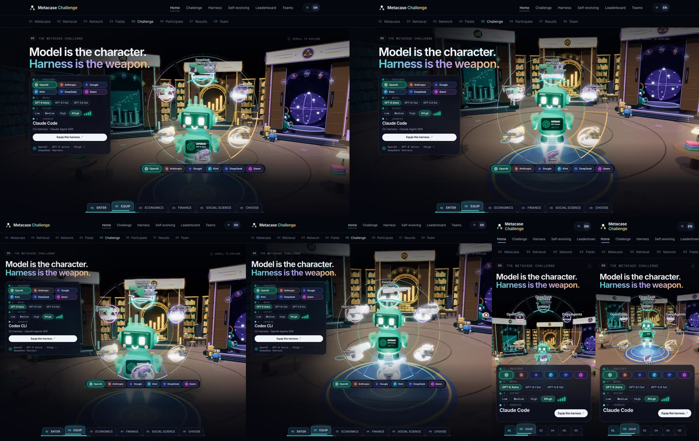
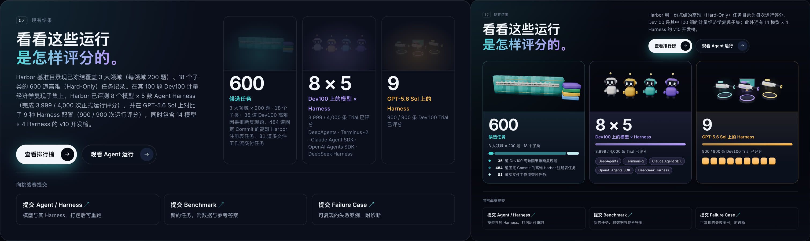
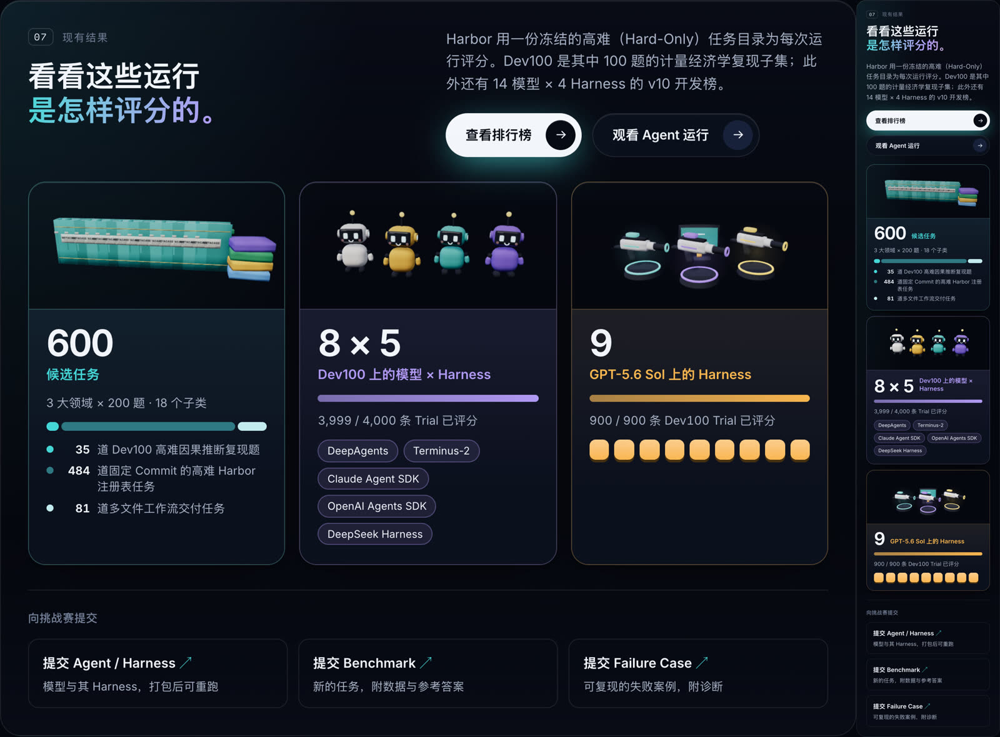
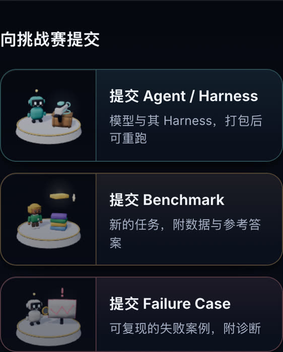
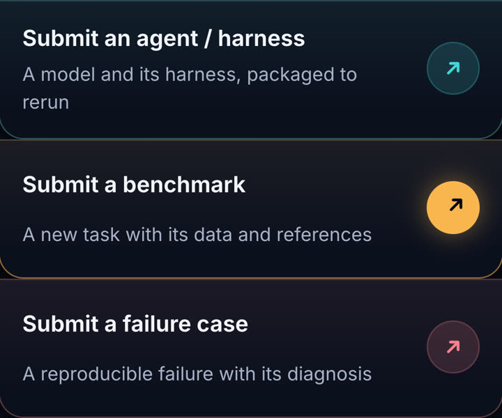

# 2026-11-02 至 11-03 网站改动说明

这两天的网站改动分两批进入 `main`：

| 批次 | 提交 | 内容 | 详细说明 |
| --- | --- | --- | --- |
| 11-02 夜间 | `db416e1` … `9b92aa2` | 卡通角色重做、Fields 玩具书、七个子页面接入首页画风 | [review-20261102/README.md](../review-20261102/README.md) |
| 11-03 | 本说明所在的提交 | Arena 机器人居中、07 结果卡片、提交卡片 | 本文件 |

网站上的数字和链接地址都没有改。

## 11-02 夜间（已在 `main`，摘要）

- **卡通角色**（`mc-kit.js`）：全站人物和机器人改成同一套更精致的造型。人物有圆脸、带高光的眼睛、六种发型和服装细节，会眨眼；机器人有胶囊眼、发光笑脸、耳机和手臂。圆角方块改用光滑法线，不再看得出棱角。
- **Fields 章的书**（`metacase.js` / `metacase.css` / `mc-classart.js`）：改成玩具书，每页一类，18 类各配一张插画。滚动时逐页翻动；换领域时旧书滑走，新书弹出。
- **七个子页面**（`subpage-toy*.js/css`）：每页页首加了一个专属 3D 小场景，标题第二行用首页的渐变色，卡片改成玩具质感，章节标题上方配插画。

## 11-03

### 1. Arena：机器人站在装备轮盘正中（`arena-scene.js`）

- **原来的问题**：画面只是固定往右挪了 7%，没有往上挪，所以机器人总是偏低；屏幕越窄，横向也偏得越多。算机器人"中间"时还把隐藏的天线算了进去，又往下偏了一点。
- **现在**：每一帧算出机器人身体中心在屏幕上的位置，再把画面挪过去，让它对准轮盘中心。手机上也这样处理。
- **大小**：在轮盘里，机器人的身高按轮盘直径定（约 44%），头和脚不会挡住上下两个武器槽。1440×900 下基本没变，窄一些的屏幕上会缩小。
- **副作用**：右上角"SCROLL TO EXPLORE"那行小字的背后，现在是一扇门的门头。

### 2. 07 结果卡片（`index.html` / `metacase.css` / `metacase-cards.js`）

- **原来看不清的原因**：三张 3D 小图画在页面后面，卡片的底色几乎不透明，上面还盖了一层色晕，小图被遮暗了。现在小图上方不再有任何遮挡，镜头也拉近了。
- **布局**：标题在左，简介和按钮在右；三张数字卡占满一整行。
- **每个数字都配了图示**：
  - 600：按比例分成三段的条（35 / 484 / 81），下面逐项说明来源。
  - 8 × 5：已评分进度条，五个 Harness 改成小标签。
  - 9：满格进度条，九个方块代表九种配置。
  - 滚到这里时进度条会填满，方块依次弹出；开启"减少动态效果"时直接显示最终状态。
- **简介**：原来的长段落和卡片内容重复，压成了两句。中文版是新写的，在 `assets/i18n/index.zh.json` 里。
- **手机**：三张卡上下排列，每张都显示完整说明。原来手机上的说明是隐藏的。

### 3. 提交卡片（同上三个文件）

- 三个提交入口改成卡片，各配一个用新建模做的 3D 小场景：
  - 提交 Agent / Harness：机器人旁边的木箱里升起 Harness 武器。
  - 提交 Benchmark：一本新任务书落到书堆上。
  - 提交 Failure Case：机器人拿放大镜看一块红边的失败案例牌。
- 每张卡有自己的颜色（青、琥珀、玫红），底下有一圈实心厚边，鼠标悬停时会弹起。
- 右下角的箭头原来是字体里的 "↗" 字符，线条细，也不居中。现在改成画出来的图标，放在同色的淡色圆上；悬停时圆变成实心，箭头往右上方弹一下。
- 手机上，场景放在文字左边，箭头圆圈去掉。
- 三个链接地址和文案都没改。

### 缓存版本号

`index.html` 中，`language.js`、`metacase.css` 和 `metacase.js` 改为 `?v=20261103-results`，`arena.js` 改为 `?v=20261103-wheel-centre`。`metacase.js` 内部的 `V` 和 `arena.js` 里对 `arena-scene.js` 的引用也同步改了，这样浏览器和中文词典都会取到新文件。

## SFF 视频

已按现在的网页重拍为 v6：`docs/video/sff-homepage/metacase-sff-stage-1080p60-v6.mp4`（134.53 s）。拍摄改动和验收结果写在 `docs/video/sff-homepage/STATUS.md` 的 v6 一节。v5 保留作对比。

## 检查结果

- `node scripts/check.mjs` 通过。
- `test-leaderboard`、`test-dev100`、`test-dual-board`、`test-run-card` 都通过。
- `test-arena.mjs` 仍在同一个过期的断言上失败：测试写着 8 个武器槽，页面实际是 6 个，和这次改动无关。
- 在 Chrome 里截图检查了 1440、1024（或 1100）和 390 宽度，中英文都看过，页面没有脚本报错。
- 还没看：Safari、Firefox、真机、低端手机的性能。
